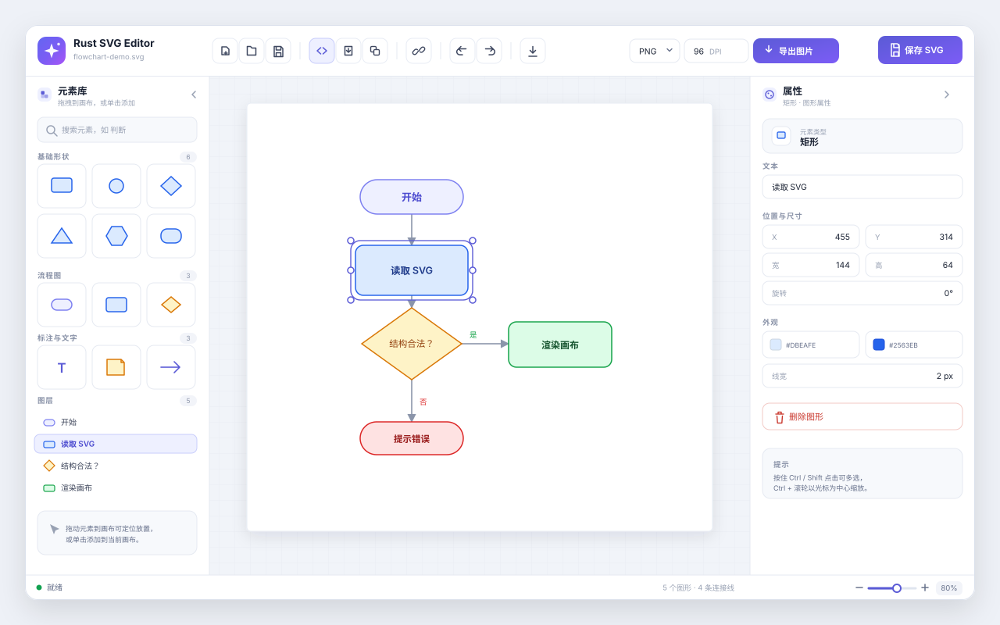

# Rust SVG Editor

一款所见即所得的 SVG 可视化编辑器，用拖拽画图、连线排版，也可直接书写 SVG 源码，所有文档以标准 `.svg` 保存。

## 功能说明

### 图形绘制

- 左侧元素库提供基础形状、流程图、标注与文字三类元素：矩形、圆角矩形、椭圆、菱形、三角形、六边形、开始/处理/判断节点、便签、箭头、文字等。
- 单击添加到画布，或直接拖拽到指定位置放置。
- 支持中英文关键词搜索（如「判断 / diamond」），并记录最近使用过的元素。
- 元素库分组可折叠，左右面板均可收起，为画布腾出空间。

### 画布与交互

- 单选、`Ctrl` / `Shift` 单击多选、空白处拖动框选。
- 拖动移动、八向手柄缩放、旋转，多选时可整体移动与批量改色。
- 网格背景，10%–400% 缩放，`Ctrl + 滚轮`以光标为中心缩放，一键适应画布。
- 画布尺寸可精确输入，也可按住 `Ctrl` 拖动边缘与四角调整。

### 连接线

- 连线模式下依次点击两个图形即可创建带箭头的连接线。
- 连接线两端自动贴合图形边界，图形移动、缩放后自动跟随。
- 支持单独调整连接线的颜色与线宽。

### 属性与图层

- 属性面板可编辑文字内容、X/Y、宽高、旋转角度、填充色、描边色与线宽。
- 多选时提供批量外观设置；未选中对象时展示画布尺寸与文档统计。
- 图层列表列出全部图形，点击即可选中定位。
- 所有编辑操作支持 100 步撤销与重做。

### SVG 源码编辑

- 可视化编辑与 SVG 源码编辑双向切换，源码修改后可直接回到画布查看结果。
- 内置源码格式化，保存时自动隐藏编辑器元数据，输出干净、可复用的标准 SVG。
- 新建、打开、保存 `.svg` 文件，SVG 即主文档格式，不产生私有工程文件。

### 导入与导出

- 导入外部 SVG 时可选择：作为一个整体对象，或拆分为多个可独立编辑的元素。
- 导入后可修改其中的文字与颜色，也可继续按层级拆分为更小的元素。
- 导出 PNG / JPEG / WebP 图片，支持自定义 DPI（1–2400）。
- 导出内置中文字体，避免文字在图片中丢失或被替换。

## 常用快捷键

| 操作 | 快捷键 |
| --- | --- |
| 全选 | `Ctrl + A` |
| 撤销 | `Ctrl + Z` |
| 重做 | `Ctrl + Shift + Z` / `Ctrl + Y` |
| 删除所选 | `Delete` / `Backspace` |
| 退出当前操作 | `Esc` |
| 多选增减 | `Ctrl` / `Shift` + 单击 |
| 以光标为中心缩放 | `Ctrl + 滚轮` |

## 适用场景

- 业务流程图、审批流与泳道图
- 系统架构图、部署图与网络拓扑图
- 组织结构图与汇报图
- 图标、简单插图与 SVG 素材整理

本地运行，文件保存在本机，无需联网即可完成全部编辑工作。
